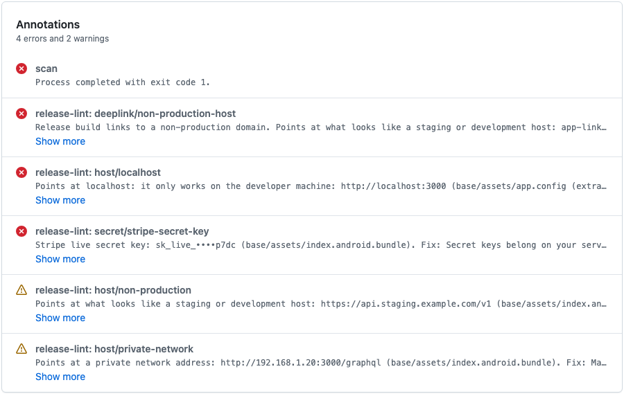

# release-lint

[](https://www.npmjs.com/package/app-release-lint)
[](https://github.com/harpreetkbadhan/release-lint/actions/workflows/ci.yml)

Lint a **built** iOS or Android app for release mistakes, right before you ship it.

```sh
npx app-release-lint app-release.ipa     # or app-release.aab
```

Or install it (`npm i -D app-release-lint`) and run `release-lint`. Node 20.19 or newer.


### Try it in 30 seconds

No app at hand? Scan the release build of [release-lint-demo](https://github.com/harpreetkbadhan/release-lint-demo), a
blank Expo app with six planted mistakes:

```sh
curl -LO https://github.com/harpreetkbadhan/release-lint-demo/releases/download/v1.0.0/release-lint-demo.aab
npx app-release-lint release-lint-demo.aab
```

Code review and source scanners look at your repository. But what ships is the file your build produced, and that file
often differs from what the repository suggests: `app.config.ts` switches on `APP_VARIANT` or env vars, Expo generates the
native projects at build time, and config plugins edit entitlements you never see. release-lint opens the final `.ipa`
or `.aab` and checks what is really inside.

> **Only scan apps you own or have permission to audit.**

Real output for a blank `create-expo-app` (Expo SDK 58, React Native 0.88) release build with five planted mistakes:

```
release-lint 0.1.0 · app-release.aab · Android · com.example.calibration 1.0.0 (1) · Hermes v99

 ERROR  secret/stripe-secret-key  Stripe live secret key
        sk_live_••••p7dc  (base/assets/index.android.bundle)
        fix: Secret keys belong on your server: anyone with the app file can read it. Call this API from your server instead, and revoke the key now.

 ERROR  host/localhost  Points at localhost: it only works on the developer machine
        http://localhost:3000  (base/assets/app.config (extra.apiUrl))
        fix: Make sure release builds use production URLs (check env-based config such as EXPO_PUBLIC_* or app.config.ts). If this host is intended, add it to allowHosts in release-lint.config.json.

 ERROR  deeplink/non-production-host  Release build links to a non-production domain. Points at what looks like a staging or development host
        app-link host staging.example.com  (base/manifest/AndroidManifest.xml)
        fix: Release builds must only claim production domains. Check associatedDomains / intentFilters in your app config (often switched by APP_VARIANT or an env var) and the Release entitlements.

 WARN   host/private-network  Points at a private network address
        http://192.168.1.20:3000/graphql  (base/assets/index.android.bundle)
        fix: Make sure release builds use production URLs (check env-based config such as EXPO_PUBLIC_* or app.config.ts). If this host is intended, add it to allowHosts in release-lint.config.json.

 WARN   host/non-production  Points at what looks like a staging or development host
        https://api.staging.example.com/v1  (base/assets/index.android.bundle)
        fix: Make sure release builds use production URLs (check env-based config such as EXPO_PUBLIC_* or app.config.ts). If this host is intended, add it to allowHosts in release-lint.config.json.

 3 errors · 2 warnings · 0 info
```

## What it checks

| Rule | Severity | What |
|---|---|---|
| `secret/*` | error | Stripe secret keys, AWS keys, private keys, OpenAI and Anthropic keys, GitHub and Slack tokens, Slack webhooks, SendGrid keys, Supabase `service_role` keys, in the JS bundle and the Expo config (`extra`) |
| `secret/stripe-test-secret-key` | warning | A Stripe test secret key |
| `secret/google-api-key` | info | Google / Firebase API keys: public by design, but should be restricted |
| `deeplink/non-production-host` | error | Staging, dev, localhost or private hosts in the **signed** iOS associated domains or Android intent filters |
| `host/*` | warning (error in Expo config) | `localhost`, `10.0.2.2`, private network addresses, ngrok and other tunnels, `.local` / `.test` domains, and staging / dev hosts |
| `debug/debuggable` | error | Android `android:debuggable`, or a development-signed iOS build (`get-task-allow`) |
| `debug/dev-bundle` | error | A development JavaScript bundle (`__DEV__` is true) |
| `debug/cleartext-traffic`, `debug/arbitrary-loads` | warning | Plain HTTP allowed everywhere (Android) or App Transport Security turned off (iOS) |
| `sourcemap/file`, `sourcemap/url` | warning | Source maps shipped inside the app, or a `sourceMappingURL` in the bundle |
| `scan/unreadable` | error | Part of the app could not be read, so it was not checked: the scan fails closed instead of passing silently |

Secrets are masked in every output, and URLs are shown without credentials or query strings, so the report is safe to
keep in CI logs. Keys that are public by design (Stripe
`pk_`, Supabase anon keys, Sentry DSNs, RevenueCat public SDK keys) are never reported. Known SDK sandbox hosts (Apple
receipt validation, PayPal, Plaid, …) are not reported either.

## Usage

```
release-lint <app.ipa|app.aab> [options]

  --json               Print the report as JSON
  --fail-on <level>    Exit 1 when a finding is at least: error (default), warning, info, none
  --config <path>      Config file (default: ./release-lint.config.json if it exists)
  --ignore <rule>      Skip a rule, e.g. host/non-production or secret/* (repeatable)
  --no-color           Plain output (NO_COLOR is respected too)
```

Exit codes: `0` nothing at or above `--fail-on`, `1` findings at or above `--fail-on`, `2` the file could not be read.

### In CI

**GitHub Actions**, after the step that builds the release file:

```yaml
- uses: harpreetkbadhan/release-lint@v0
  with:
    file: android/app/build/outputs/bundle/release/app-release.aab
    # fail-on: warning               # error (default), warning, info, none
    # config: release-lint.config.json
```

Findings appear as annotations on the run page and as a table in the job summary. The action uses the runner's Node
(20.19 or newer; add `actions/setup-node` first if yours is older).

[](https://github.com/harpreetkbadhan/release-lint-demo/actions/runs/45593915116)

**Any other CI:** `npx app-release-lint@0 path/to/app.aab`. Exit code 1 fails the step.

**EAS Build:** a build hook in `package.json` runs it on the build worker after every successful Android build (the path
assumes the default `bundleRelease` Gradle command):

```json
{
  "scripts": {
    "eas-build-on-success": "[ \"$EAS_BUILD_PLATFORM\" != android ] || npx app-release-lint@0 android/app/build/outputs/bundle/release/app-release.aab"
  }
}
```

For a local build: `eas build --local --platform ios --profile production --output app.ipa && npx app-release-lint app.ipa`.

### Config file

`release-lint.config.json` in the working directory:

```json
{
  "failOn": "error",
  "allowHosts": ["cdn-staging.example.com", "*.internal.example.com"],
  "ignore": [{ "rule": "host/non-production", "match": "sandbox.example.com" }, { "rule": "secret/google-api-key" }]
}
```

`allowHosts` entries are exact hosts or `*.` suffixes. An `ignore` entry skips a rule (`secret/*` skips a whole group),
optionally only for findings whose evidence or location contains `match`. Unknown keys are an error, so a typo cannot
silently turn a check off.

In CI, anyone who can open a pull request can edit this file, so review changes to it like code (for example with
`CODEOWNERS`).

### With AI coding agents

[`skills/release-lint/SKILL.md`](skills/release-lint/SKILL.md) teaches Claude Code, Codex and similar agents to run
release-lint on your build and fix the findings at their source.

## How it works

release-lint reads the app file in place. It never extracts it to disk, never sends anything over the network, and has
no runtime dependencies. It parses:

- the zip container (including zip64), reading only the handful of entries it needs;
- `Info.plist` (binary and XML) and the **entitlements inside the code signature** of the iOS executable, which are the
  values the app was actually signed with (`embedded.mobileprovision` only lists what the profile allows);
- the protobuf `AndroidManifest.xml` of an `.aab`;
- the string table of a Hermes bytecode bundle, or a plain JavaScript bundle, and the embedded Expo config.

## Why not MobSF, gitleaks or trufflehog?

[MobSF](https://github.com/MobSF/Mobile-Security-Framework-MobSF) is a full mobile security suite: a server you run, with
a large pentest report. gitleaks and trufflehog scan source and git history, not built apps. release-lint does one
narrower job: a few seconds, no setup, in any CI step, and a short list of release mistakes with a fix for each.

## Limits (0.1.x)

- `.apk` files are not supported yet; scan the `.aab` you upload to Google Play.
- Android hosts written as resource references (`@string/…`) are reported but not resolved yet.
- Native code (`classes.dex`, the iOS executable's strings) is not scanned for secrets: SDKs make that too noisy.
- Permissions checks, SARIF output and online validation of `apple-app-site-association` / `assetlinks.json` are planned.

## License

MIT
